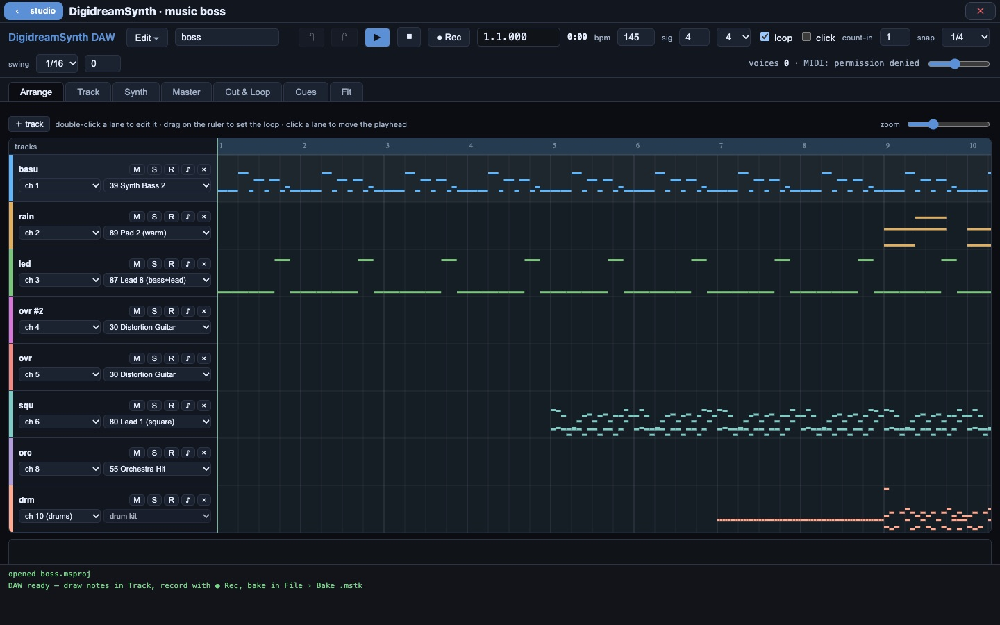

# DigidreamSynth

A small music workstation with its own synthesizer, for game music. You write
tracks in a piano roll or record them from a MIDI keyboard, design the
instruments, master the mix, cut the song into loops, and test how the game
will switch between them. The game then synthesizes the music itself, with the
same engine you heard in the editor, so what ships is exactly what you
auditioned. No audio samples are used: every instrument is synthesized.



## Download

The latest release is at
[github.com/projectdigidream/digidream-midisynth/releases/latest](https://github.com/projectdigidream/digidream-midisynth/releases/latest):

| Platform | File |
|---|---|
| macOS, Apple silicon | `digidream-midisynth-<version>-macos-arm64.dmg` (or `.zip`) |
| macOS, Intel | `digidream-midisynth-<version>-macos-x64.dmg` (or `.zip`) |
| Windows x64 | `digidream-midisynth-<version>-windows-x64-setup.exe`, a `-portable.exe` that needs no install, or a `.zip` |
| Linux x64 | `digidream-midisynth-<version>-linux-x64.AppImage`, `.deb` or `.tar.gz` |
| Android | `digidream-midisynth-<version>-android.apk` (sideload it) |
| Web | `digidream-midisynth-<version>-web.zip`: a static site to host yourself |

**macOS:** the apps are not notarized. The first time, open System Settings >
Privacy & Security and click **Open Anyway**.

**Web:** unzip, then `cd web && node serve.js --root .` and open
`http://localhost:8930/`. On another host, serve the folder over HTTPS: browsers
only allow the audio engine and Web MIDI in a secure context (`localhost` counts
as one), and `.mjs` files must be served as `text/javascript`.

DigidreamSynth also comes inside **Digidream Studio**
([digidream-studio](https://github.com/projectdigidream/digidream-studio)) as a
plugin. There you do not need this download: in the studio's Music page, press
**+ new track**, or **edit in DigidreamSynth** on one. The editor opens over the
studio, **‹ studio** saves the project back into your module, and the studio
bakes it into the track the game plays.

## Use it

The app opens on the DAW, one page with six tabs:

- **Arrange**: the tracks (one track is one MIDI channel; channel 10 is drums),
  their instruments, mute and solo. Drag on the ruler to set the loop.
- **Track**: the piano roll. Draw, select and erase notes; edit velocity, a
  controller or pitch bend in the lane below. Arm a track and press **● Rec**
  to record from a MIDI keyboard, with count-in, click, quantize and overdub.
- **Synth**: the instrument editor for the selected track's patch: wavetables,
  filters, envelopes, LFOs, effects. Edits are heard at once.
- **Master**: EQ, compressor, saturation, limiter and meters, plus per-track EQ
  and the reverb, chorus and delay sends.
- **Cut & Loop**: bake the song and cut it into loops ("slices") for the game.
- **Cues**: test how pieces follow each other: switch at the end of a loop, at
  the next bar, or with a crossfade, and chain them the way a level will.

Changes to notes are heard while the song plays, without stopping it. The full
guide is [docs/DAW.md](docs/DAW.md).

### Files

| File | What it is |
|---|---|
| `.msproj` | the project you edit: JSON, with the tracks, the instruments, the mastering, the slices and the cues. Keep this one |
| `.mstk` | a baked track, the file the game plays (**File > Bake .mstk**) |
| `.mid` | Standard MIDI Files: import a song, or export yours |
| `.wav` | an offline render of the song |
| `bank.json`, `kit.json`, `fx.json`, `master.json` | the instruments, the drum kit, the effects and the mastering, as separate files |
| `cues.json` | the cue board from the Cues tab |

You can drag any of these onto the page. The instrument and kit format is
described field by field in [docs/PATCH_FORMAT.md](docs/PATCH_FORMAT.md).

The web build also has two single-purpose pages: the instrument editor on its
own (`tool/`), and the track cutter (`tool/cutter.html`).

## Build from source

DigidreamSynth uses one header from the **Digidream Engine**
(`dnp/math/fixed.hpp`, the fixed-point types), so a build needs the engine
checked out beside it, in a folder named `engine`:

```sh
mkdir digidream && cd digidream
git clone https://github.com/projectdigidream/digidream-midisynth.git midisynth
git clone https://github.com/projectdigidream/digidream-engine.git engine
cd midisynth
```

The command-line player needs [miniaudio](https://github.com/mackron/miniaudio)
(public domain or MIT-0), which is not in the repository. Download the single
header, version 0.11.25:

```sh
mkdir -p third_party/miniaudio
curl -L -o third_party/miniaudio/miniaudio.h \
  https://raw.githubusercontent.com/mackron/miniaudio/0.11.25/miniaudio.h
```

You need:

- a C++17 compiler (clang or gcc), CMake 3.20 or newer and Ninja
- Node (the editor's server, the tests and the app packaging)
- Python 3 (the golden tests generate their MIDI files with it)
- Emscripten, for the WebAssembly engine the editor runs on. The engine pins
  version 6.0.8 (its `scripts/setup_emsdk.sh`); that is the one these builds
  are tested with. The script finds `em++` in `../emsdk` or on your `PATH`
  (after `source emsdk_env.sh`).

The editor's engine file (`tool/dist/midisynth.mjs`) is build output and is not
in the repository, so build it first:

```sh
./scripts/build_wasm.sh       # -> tool/dist/midisynth.mjs
node tool/serve.js            # then open http://localhost:8930/tool/daw.html
```

The native library, the command-line tools and the tests:

```sh
cmake -S . -B build -G Ninja && ninja -C build
```

Packaging (each one runs `package_web.sh` first, so all of them ship the same
pages):

```sh
./scripts/package_web.sh             # a static site in dist-web/ (+ dist-web.tar.gz)
./scripts/package_electron.sh        # the desktop app for this machine, in electron/dist/
./scripts/package_electron.sh --all  # macOS (arm64 + x64), Windows x64 and Linux x64
./scripts/package_android.sh         # mobile/android/app/build/outputs/apk/debug/app-debug.apk
```

The desktop app uses Electron, which `package_electron.sh` installs with npm on
its first run (`electron/README.md` has the details). The Android app uses
Capacitor and Gradle: it needs `ANDROID_HOME` pointing at an Android SDK, and
JDK 21 (or Android Studio, whose bundled JDK the script uses). `deploy/` has an
nginx config, a Caddyfile, a Dockerfile and a systemd unit for hosting the web
build.

## Development

Tests, the command-line tools, the baked track format, mastering, and how the
engine stays identical on every platform: [DEVELOPING.md](DEVELOPING.md).

## Licence

MIT, see LICENSE.
